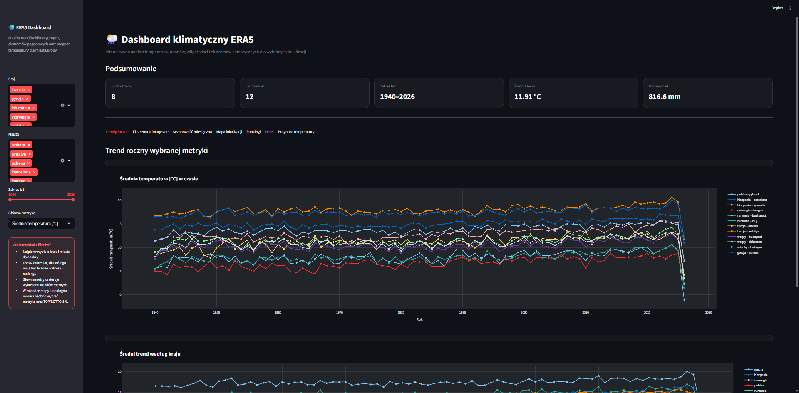

# 🌦️ Data Analysis in Earth Sciences

## Dashboard klimatyczny ERA5

Aplikacja Streamlit służąca do interaktywnej analizy danych klimatycznych ERA5 dla wybranych lokalizacji w Europie.

---

## 🚀 Uruchomienie dashboarda

Plik aplikacji:
app_streamlit_era5_dashboard.py

---

## 🧱 1. Utworzenie środowiska (jeśli nie masz)

Otwórz Anaconda Prompt i wpisz:

conda create -n streamlit_env python=3.11 -y

Następnie aktywuj środowisko:

conda activate streamlit_env

Zainstaluj wymagane biblioteki:

python -m pip install streamlit pandas pyarrow plotly

---

## 🔁 2. Aktywacja istniejącego środowiska

Jeżeli środowisko już istnieje:

conda activate streamlit_env

---

## 📂 3. Przejście do katalogu projektu

Przejdź do folderu, w którym znajduje się dashboard:

cd "ścieżka_do_folderu"

Przykład:

cd "C:\Users\TwojaNazwa\Projekt"

---

## ▶️ 4. Uruchomienie aplikacji

python -m streamlit run app_streamlit_era5_dashboard.py

Po uruchomieniu aplikacja automatycznie otworzy się w przeglądarce.

---

## 📊 Funkcjonalności dashboarda

Dashboard umożliwia:
- filtrowanie danych (kraj, miasto, zakres lat),
- analizę trendów klimatycznych w czasie,
- analizę ekstremów (upały, mróz, ulewy),
- analizę sezonowości miesięcznej,
- wizualizację danych na mapie Europy,
- generowanie rankingów (TOP / BOTTOM lokalizacji),
- eksport danych do pliku CSV,
- prognozy temperatury powietrza.

---

## 🖼️ Podgląd aplikacji

